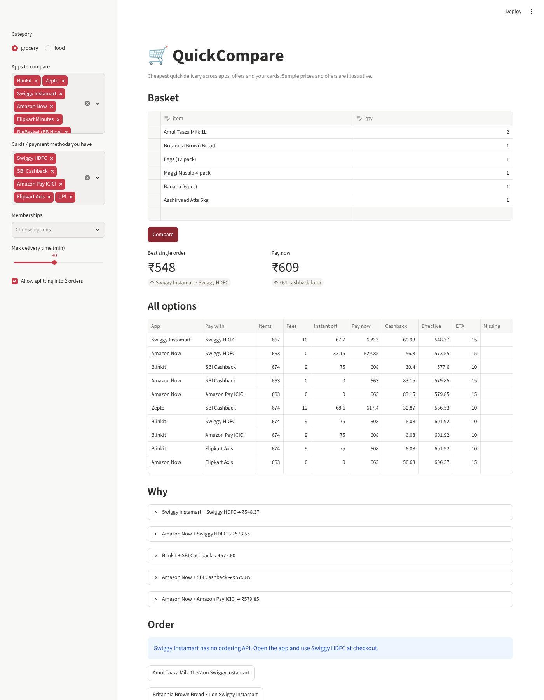

# QuickCompare

Compares quick-delivery apps (Blinkit, Zepto, Instamart, Amazon Now, Flipkart Minutes, BigBasket, Swiggy, Zomato) for a basket. For each app × payment method it works out:

**effective cost = items + fees − coupon − bank/card instant offer − cashback − card rewards**

It can also split the basket across two apps when that works out cheaper even after paying fees twice.



```bash
cd quickcompare
pip install -r requirements.txt
streamlit run app.py
pytest
```

## How it fits together

| Piece | File | What it does |
|---|---|---|
| Data types | `quickcompare/models.py` | Listing, fees, offers, payment methods, quotes |
| Pricing engine | `quickcompare/pricing.py` | Applies fees and memberships, then the best coupon, then the best bank offer on the post-coupon amount, then cashback and card rewards |
| Optimizer | `quickcompare/optimizer.py` | Ranks every app × card for one order. For split orders it runs an exact DP over item subsets (up to 12 items) |
| Connectors | `quickcompare/connectors/` | `mock` (sample prices), `manual` (you type prices, deep link to order), `mcp_connector` (Swiggy/Zomato official MCP servers) |
| Your setup | `data/*.yaml` | Fees per app, active offers, the cards you own and their reward rates |

### Offers model (`data/offers.yaml`)
- `type: percent | flat`, `max_discount`, `min_order`, `min_items` (e.g. "₹50 cashback on 6+ items")
- `payment_method:` ties an offer to a card or UPI (e.g. "Instamart 10% with HDFC")
- `realization: instant | cashback`. Cashback is subtracted from effective cost but not from "pay now"
- `group:` offers in the same group don't stack (one coupon plus one bank offer per order)
- `value_factor:` what ₹1 of a cashback is really worth to you (points or wallet credit < 1.0)

Card base rewards live in `data/payment_methods.yaml` (e.g. Swiggy HDFC 10% on Swiggy apps, 1% elsewhere).

**All prices, fees, offers and card rates in `data/` are illustrative.** Update them from the apps and your card terms.

## Getting real prices and placing orders

| App | Official programmatic access | Status here |
|---|---|---|
| Swiggy Instamart / Food / Dineout | Official MCP servers (Swiggy Builders Club, OAuth) | `mcp_connector`, set `connector: swiggy_mcp` |
| Zomato (food) | Official MCP server (access by request, OAuth) | `mcp_connector`, set `connector: zomato_mcp` |
| Blinkit, Zepto, Amazon Now, Flipkart Minutes, BigBasket | No public ordering API | `manual` prices + deep link to the app |

To turn on an MCP connector:
1. Get access and an OAuth token for your account, then export it, e.g. `INSTAMART_MCP_TOKEN=...`
2. List the server's tools: `MCP_TOKEN=... python -m quickcompare.connectors.mcp_connector https://mcp.swiggy.com/im`
3. In `platforms.yaml` set `connector: swiggy_mcp` and map the tools:
   ```yaml
   mcp:
     url: https://mcp.swiggy.com/im
     token_env: INSTAMART_MCP_TOKEN
     tools: {search: <tool>, add_to_cart: <tool>, checkout: <tool>, apply_coupon: <tool>}
     fields: {items: <list key>, price: <price key>, title: <name key>, id: <id key>}
   ```
The app only places an order after you tick an explicit confirmation.

The MCP connector has **not been tested against the live servers** because that needs approved access.

Scraping the other apps or automating their private APIs breaks their terms of service and can get your account blocked, so it isn't done here.

## Ideas for next steps
- Read live offers from the MCP servers' coupon tools instead of the YAML
- Monthly cashback caps (track spend per card) rather than per-order caps
- Better product matching across apps (pack size and brand normalisation)
- Dineout/District: compare bill discounts for a table booking
